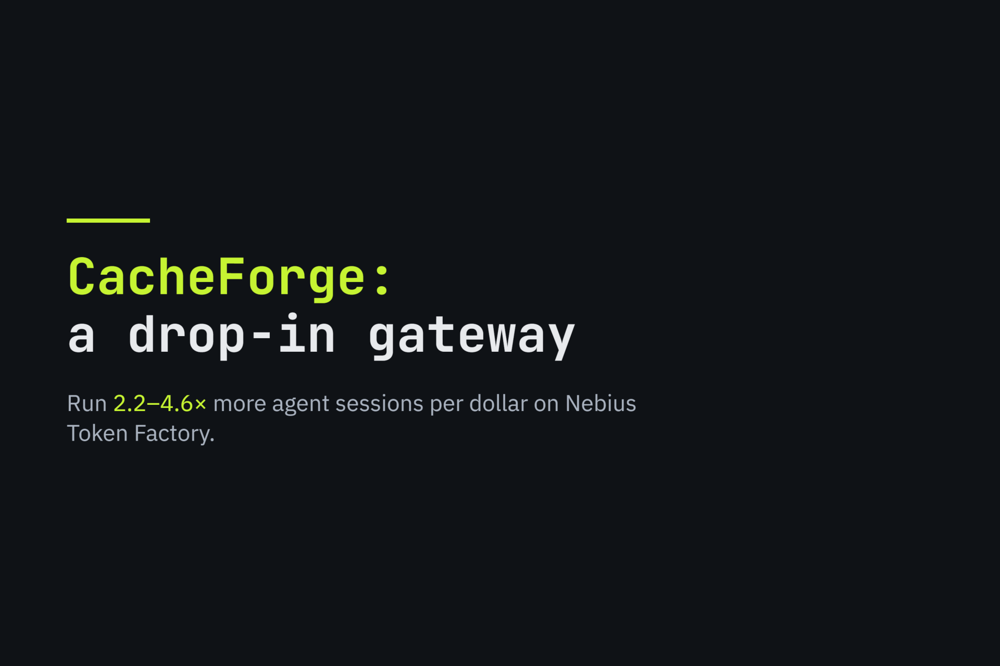
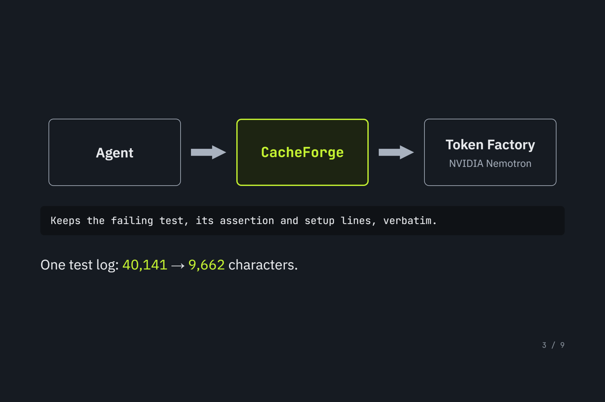
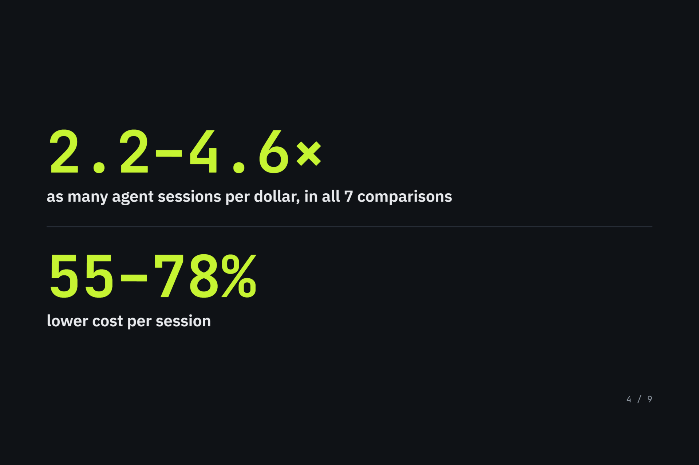
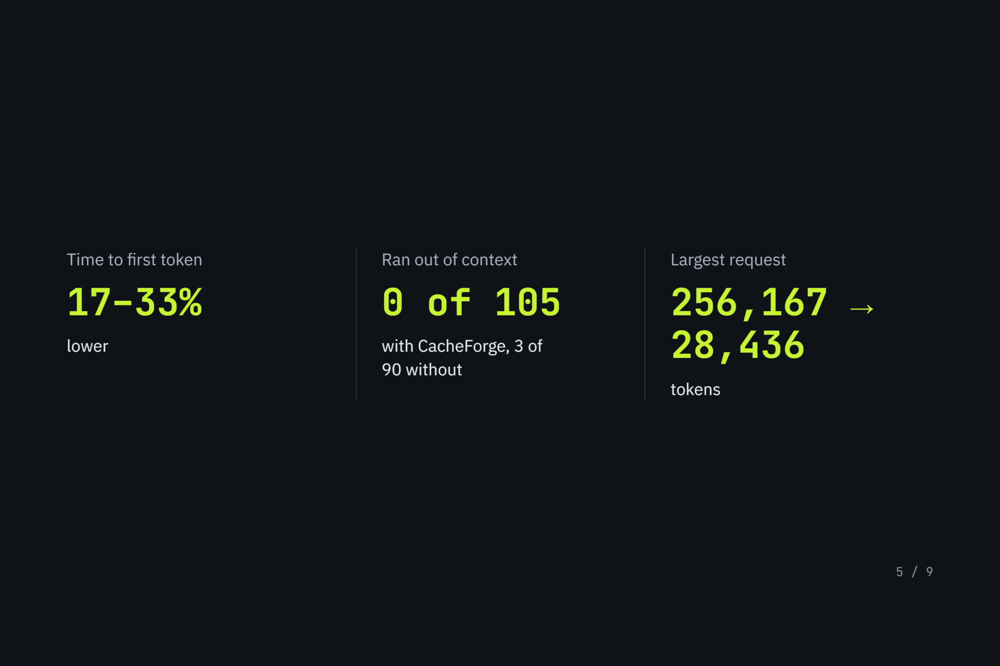
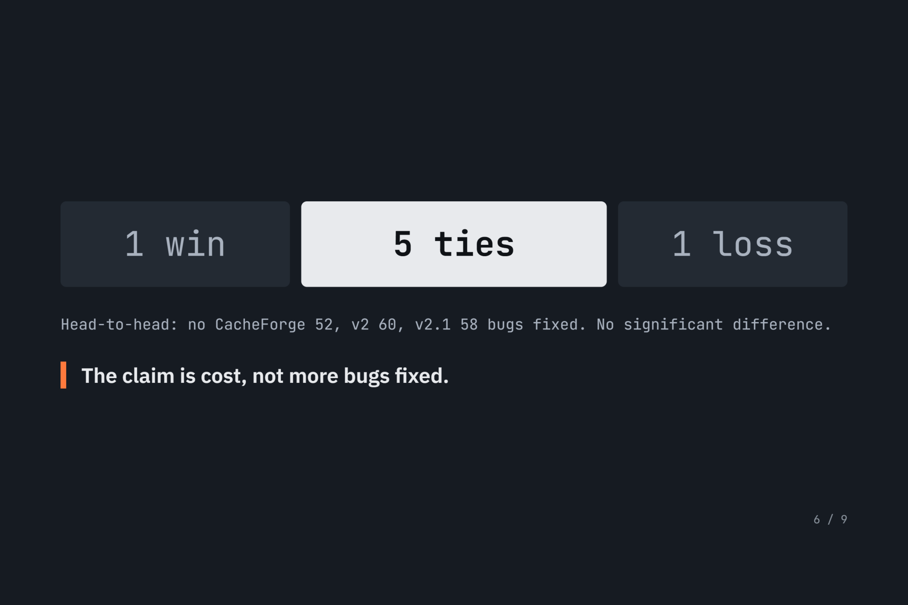
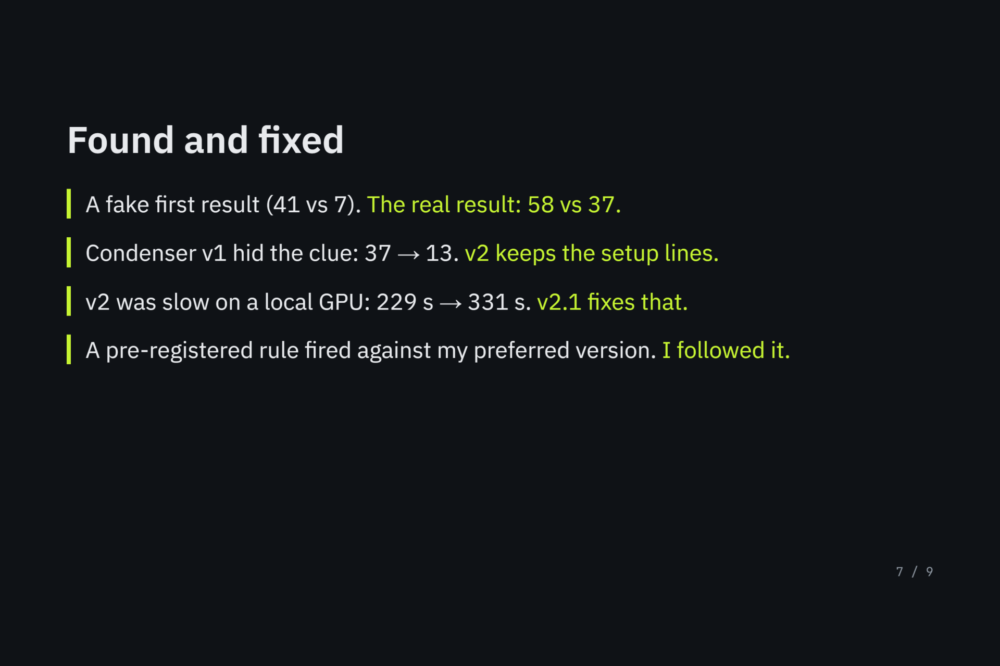
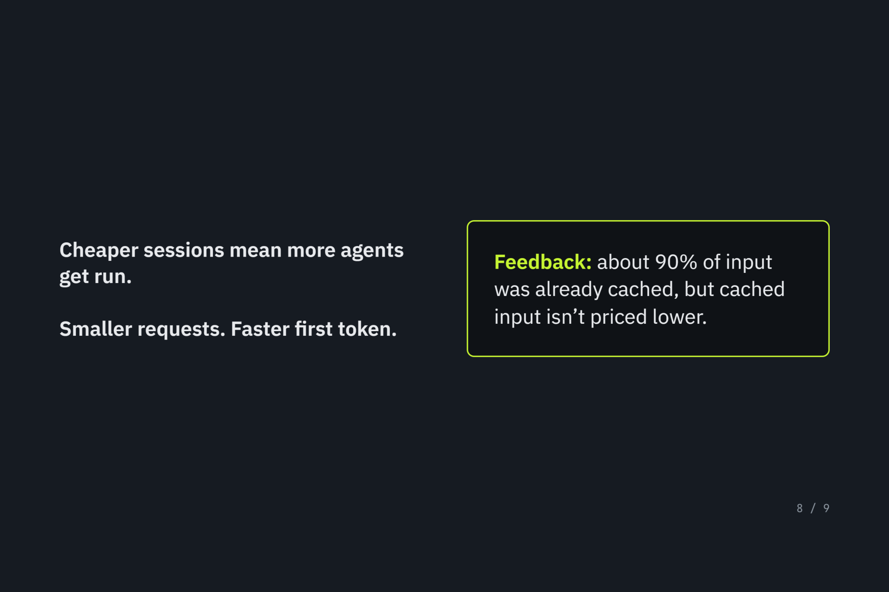
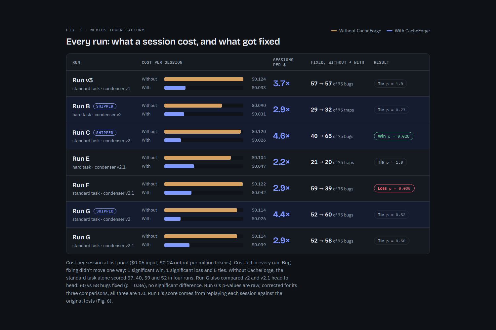

# RunSift

<p align="center">
  <a href="https://runsift.fieldsmith.pro">
    
  </a>
</p>

<p align="center">
  <a href="https://runsift.fieldsmith.pro"><b>Interactive 3D Site &amp; Live Browser Playground (runsift.fieldsmith.pro)</b></a>
  &nbsp;·&nbsp;
  <a href="https://youtu.be/tR6yUj1db1E"><b>2-Minute Demo Video (YouTube)</b></a>
  &nbsp;·&nbsp;
  <a href="media/slides/RunSift_slides.pdf"><b>Slide Deck (PDF)</b></a>
  &nbsp;·&nbsp;
  <a href="media/images/"><b>Slide Images</b></a>
  &nbsp;·&nbsp;
  <a href="benchmarks/tensorroute_benchmark/PRE_REGISTRATION.md"><b>Pre-Registration Ledger</b></a>
</p>

**A drop-in, OpenAI-compatible gateway for coding agents on Nebius Token Factory.** Coding agents re-send every tool output (such as test logs) on every turn. RunSift deterministically condenses noisy tool logs before the request reaches **NVIDIA Nemotron** on Nebius Token Factory — keeping pass/fail counts per file and every failing test's setup, assertion, and traceback verbatim while dropping passing-test noise. In all 7 pre-registered Token Factory comparisons, the same budget ran **2.2–4.6× as many agent sessions** (55–78% lower cost per session). Your agent changes one setting: its `base_url`.

---

## Quickstart (Judge & Developer Verification in 30 Seconds)

| Mode | Needs API Key? | Command | What You See |
| :--- | :---: | :--- | :--- |
| **1. Condense a real log** | **No** | `uv run runsift condense` (from a clone) | Condenses a real 646-line (`40,141` char) pytest log from Run C down to 145 lines (`9,662` chars, `−75.9%`). |
| **2. Browse all 7 runs (TUI)** | **No** | `uv run runsift replay` | Interactive terminal app: browse all 7 pre-registered Token Factory runs and step turn-by-turn through raw vs. condensed outputs. |
| **3. Live Gateway + Web Dashboard** | **Yes** (`NEBIUS_API_KEY`) | `uv run runsift serve` | Starts the gateway at `http://127.0.0.1:8765`, opens **[http://127.0.0.1:8765/dashboard](http://127.0.0.1:8765/dashboard)**, and lets you click **▶ Demo: 3 live turns with a synthetic test log** against Nemotron 3 Nano (real model calls, simulated pytest log & diff; `MOCK M-013`). |

### 1. Try in 1 command with `uvx` or `uv run` (No API Key Needed)

```bash
# From a clone: condenses the real Run C log (40,141 -> 9,662 chars)
uv run runsift condense

# Without cloning (via uvx): condenses a short built-in sample log
uvx --from git+https://github.com/sahilshingate01/RunSift.git runsift condense

# Or pipe your own pytest output into Condenser v2:
pytest | uv run runsift condense -
```

### 2. Start the Live Gateway (`:8765`), Web Dashboard & Terminal Monitor

```bash
# Start the interactive setup wizard + OpenAI-compatible reverse proxy at http://127.0.0.1:8765/v1:
export NEBIUS_API_KEY="your-token-factory-key"   # PowerShell: $env:NEBIUS_API_KEY="your-token-factory-key"
uv run runsift serve                          # Or headless: uv run runsift serve --no-wizard
```

- **Live Web Dashboard:** Open **[http://127.0.0.1:8765/dashboard](http://127.0.0.1:8765/dashboard)** and click **▶ Demo: 3 live turns with a synthetic test log** to dispatch a 3-turn debugging loop (`Cold Prefill` → `9.4 KB Synthetic Pytest Condense` → `Stale Log Rewrite + Synthetic Git Diff`) with real model calls to Nebius Token Factory (synthetic test log & diff declared under `MOCK M-013`) and watch the telemetry cards, charts, and request ledger update live.
- **Live Agent Traffic Script (Terminal):** Run a 2-turn tool-calling agent against the running gateway:
  ```bash
  python examples/run_agent_traffic.py
  ```
- **Live Terminal Monitor (TUI):** Watch requests in your terminal:
  ```bash
  uv run runsift watch
  ```

### 3. Connect Any Agent (Change One Setting: `base_url`)

```python
from openai import OpenAI

client = OpenAI(
    base_url="http://127.0.0.1:8765/v1",
    api_key="any-or-gateway-key",
)

reply = client.chat.completions.create(
    model="nvidia/NVIDIA-Nemotron-3-Nano-30B-A3B",
    messages=[{"role": "user", "content": "Hello"}],
)
```

Or with any CLI coding agent / LangGraph / OpenAI-compatible framework:

```bash
export OPENAI_BASE_URL="http://127.0.0.1:8765/v1"
export OPENAI_API_KEY="local-gateway"
```

### 4. Browse All 7 Recorded Benchmark Runs in the Terminal App (No API Key)

```bash
git clone https://github.com/sahilshingate01/RunSift.git
cd RunSift
uv run runsift replay
```

Step turn-by-turn through every recorded 40-turn session: inspect what the agent's tools returned alongside the exact condensed input RunSift sent to Nemotron (recomputed locally and verified byte-for-byte against the recorded run headers).

---

## Visual Overview (Slide Deck)

| How It Works | Sessions per Dollar & Cost |
| :---: | :---: |
|  |  |
| **Latency & Context Safety** | **Quality Record (Honest Accounting)** |
|  |  |
| **Found and Fixed** | **Why It Matters on Token Factory** |
|  |  |

<p align="center">
  
</p>

---

## Results

Every run below was **pre-registered** in [`PRE_REGISTRATION.md`](benchmarks/tensorroute_benchmark/PRE_REGISTRATION.md): the metric, the statistical test (a two-sided paired exact permutation test) and the sample size (15 paired sessions) were fixed before running. Every number traces to a committed result file in [`benchmarks/tensorroute_benchmark/results/`](benchmarks/tensorroute_benchmark/results/).

### On Nebius Token Factory (NVIDIA Nemotron 3 Nano, full 262,144-token context)

The default condenser is **v2**. All costs are per session at list price ($0.06 input, $0.24 output per million tokens). Run G tested v2 and v2.1 against the same baseline at the same time, so it has two rows.

| Run | Task | Condenser | Prompt tokens per session | Cost per session | Sessions per dollar | Fixed, without → with |
|---|---|---|---|---|---|---|
| v3 | standard | v1 | −74% | $0.124 → $0.033 | 3.7× | 57 → 57 (p = 1.0) |
| B | hard | **v2** | −66% | $0.090 → $0.031 | 2.9× | 29 → 32 (p = 0.77) |
| C | standard | **v2** | −79% | $0.120 → $0.026 | 4.6× | 40 → **65** (p = 0.028) |
| E | hard | v2.1 | −56% | $0.104 → $0.047 | 2.2× | 21 → 20 (p = 1.0) |
| F | standard | v2.1 | −66% | $0.122 → $0.042 | 2.9× | 59 → **39** (p = 0.035) |
| G | standard | **v2** | −79% | $0.114 → $0.026 | 4.4× | 52 → 60 (p = 0.52) |
| G | standard | v2.1 | −66% | $0.114 → $0.039 | 2.9× | 52 → 58 (p = 0.50) |

- **Tasks:** *standard* is 5 independent bugs, so 75 per run. *Hard* is bugs that interact across modules, scored as 75 traps per run.
- **Result files:** `nebius_gauntlet_nemotron_30b_40turn_v3_*`, `nebius_coupled_nemotron_30b_40turn_v2_*`, `nebius_gauntlet_nemotron_30b_40turn_v2_*`, `nebius_coupled_nemotron_30b_40turn_v2_1_*`, `nebius_gauntlet_nemotron_30b_40turn_v2_1_*` and `nebius_gauntlet_nemotron_30b_40turn_runG_*`.
- **Run F's score:** it was 40 as first recorded (p = 0.0498). One session had edited a test file and been scored against the edited test. The `_rescored` files replay every session against the original tests.
- **Run G's p-values** are raw. After the pre-registered Holm–Bonferroni correction for its three comparisons, all three are 1.0.

What held in every Token Factory run:
- **Cost per session fell 55–78%.**
- **The median time to first token fell 17–33%.**
- **No RunSift session ran out of context:** none of 105. Three of the 90 baseline sessions did, even with the 262k window.
- **Requests got much smaller.** In Run C, the largest baseline request was 256,167 tokens; the largest RunSift request was 28,436.

**Quality is a mixed record:** one significant win (C), one significant loss (F) and five ties. Run G repeated Run C's comparison and found no significant difference (60 vs 52). The baseline alone scored 57, 40, 59 and 52 in four runs of the same task, so single runs swing a lot. What RunSift reliably does is cut cost. It doesn't reliably make the agent fix more bugs.

### v2 for Token Factory, v2.1 for local GPUs

- **What v2.1 does:** it never rewrites earlier messages. That fixes v2's slowdown on local GPUs (below).
- **How it became the default:** it passed its pre-registered local test (Run D: 30 → 24 traps, p = 0.43; no measurable slowdown, p = 0.41, median session 161 s vs 200 s without RunSift) and tied on Token Factory's hard task (Run E).
- **Why it lost the default:** before Run F, the pre-registration (section 11.5) said the default goes back to v2 if v2.1 is significantly worse on the standard task. It was, so v2 is the default.
- **What caused the loss:** three sessions account for 12 of Run F's 20-bug gap, and each went wrong before v2 and v2.1 could send the model different input:
  - two ran the tests only once, so v2 would have sent exactly the same input for the whole session;
  - in the third, the model stopped calling tools and wrote JSON plans instead, starting with its first reply.

  So Run F doesn't show that v2 is better than v2.1. A pre-registered probe then re-sent the exact request where one of those sessions first broke, 40 times with the raw test log and 40 times with the condensed one. The failure was not reproduced in a 40-vs-40 probe (5 of 40 vs 1 of 40): 5 condensed replies and 1 raw reply had no tool call (p = 0.20), and none of the 80 was a JSON plan.
- **The head-to-head (Run G, section 13):** v2, v2.1 and no RunSift ran at the same time. v2 fixed 60 bugs and v2.1 fixed 58 (p = 0.86), no significant difference. Under the rules fixed before the run:
  - **v2 stays the default.** It's also cheaper on Token Factory: v2.1 sent 57% more prompt tokens per session (630,425 vs 400,420, p = 0.003), so its sessions cost $0.039 against v2's $0.026.
  - **v2.1 is the recommended setting on a local GPU,** where it avoids v2's slowdown (Run D). Set `RUNSIFT_CONDENSER=v2.1`.

### With a small context window (local llama.cpp, 32,768 tokens, condenser v1)

| Model | Fixed, without → with | Sessions that ran out of context |
|---|---|---|
| Nemotron 3 Nano | 37 → **58** (p = 0.047) | 13 → 0 of 15 |
| Gemma 4 26B | 30 → **71** (p = 0.0001) | 15 → 0 of 15 |

Result files: `local_gauntlet_nemotron_30b_40turn_v3_*_rescored.json` and `local_gauntlet_gemma4_26b_40turn_v3_*_rescored.json`.

### Where it failed, and what changed

- **Condenser v1 on the hard task, locally at 131k: 37 → 13 traps (p = 0.004).** It kept each failing assertion but dropped the lines showing which code produced the bad value (`local_coupled_nemotron_30b_40turn_*`). v2 keeps those lines. The hard task then scored 39 → 32 locally (p = 0.20) and 29 → 32 on Token Factory.
- **v2 is slower on a local GPU.** It shrinks old test logs once newer ones arrive. That rewrites earlier messages, so llama.cpp re-reads most of the prompt after every test run: the median session went from 229 s to 331 s (`local_coupled_nemotron_30b_40turn_v2_*`). On Token Factory, v2 sessions were faster (Run B: median 51 s → 40 s), because prefill is fast there. On a local GPU, use `RUNSIFT_CONDENSER=v2.1`, which avoids the slowdown and tied v2 head to head in Run G (above).
- **v2 hid test-suite hangs, now fixed.** When a test run timed out, the condensed log dropped the timeout line and reported partial counts as if the run had finished. It now says the run didn't finish and keeps the timeout line verbatim. The fix came after Runs A–F, and there's no evidence it changes results: agents that saw the raw timeout message never recovered (0 of 10 sessions), and in Run G the one session that hung with the fixed log didn't recover either.

### Cost if cached input were cheaper

In every Token Factory run, about 90% of baseline prompt tokens were reported as cached. Token Factory lists no lower price for cached input. If cached tokens cost a tenth, RunSift would still cut cost per session by 38–62% across the runs (41–61% for v2).

---

## How it works

```
coding agent ──► RunSift gateway ──► Nebius Token Factory (NVIDIA Nemotron)
                  condenses tool output
```

- **Only tool output is condensed.** System prompts, user messages and the model's own replies pass through byte for byte.
- **Code is never trimmed.** File reads, `grep`, `cat`, code search and similar tools are exempt, so the text the agent edits is exact.
- **For test output, it keeps what's needed to fix a failure:**
  - pass and fail counts per file;
  - each failing test's name, assertion, error lines and location;
  - the lines in the test that set up what the assertion checks;
  - if the run didn't finish (for example, it timed out), a line saying so, plus the timeout message.

  Every kept line is copied verbatim. Lines over 600 characters keep their start and end.
- **Test output is recognized** whether it comes from a dedicated `run_pytest` or `pytest` tool or from a shell tool (`bash`, `execute_bash`, …), by pytest's own output format. The benchmarks used a dedicated `run_pytest` tool with `-vv -ra --tb=long`. For that format the shell path gives byte-identical output, checked by replaying every recorded test log. Other pytest formats are covered by unit tests, not benchmarks. Other test runners get the generic summary.
- **It's deterministic and idempotent.** The same input always gives the same output, and condensing condensed output changes nothing. There's no extra model call, so it can't invent a test result.
- **Visibility:** each response carries `x-runsift-condenser`, `x-runsift-tool-chars-before` and `x-runsift-tool-chars-after`.
- **Bypass:** send `x-runsift-disable-compaction: true` on any request to pass it through unchanged.

### Local development setup & configuration

```bash
git clone https://github.com/sahilshingate01/RunSift.git
cd RunSift
python -m venv .venv
.venv\Scripts\activate          # Windows; on macOS/Linux: source .venv/bin/activate
pip install -e ".[dev]"
```

Create a `.env` file in the repo root; it's loaded automatically ([`.env.example`](.env.example) has placeholders):

| Variable | Default | Meaning |
|---|---|---|
| `NEBIUS_API_KEY` | (required) | Your Token Factory key. Keep it in `.env`, which is git-ignored. |
| `NEBIUS_BASE_URL` | `https://api.tokenfactory.nebius.com/v1` | The upstream endpoint. |
| `RUNSIFT_API_KEY` | (unset) | If set, clients must authenticate to the gateway. |
| `RUNSIFT_CONDENSER` | `v2` | The condenser version: `v1`, `v2` or `v2.1`. |
| `MAX_TOOL_OUTPUT_TOKENS` | `1000` | Tool outputs longer than about 4× this many characters are condensed. |
| `ENABLE_NEGATIVE_COMPACTION` | `true` | Set to `false` to pass tool output through unchanged. |
| `ENABLE_CANONICALIZER` | `true` | Keeps prompt prefixes byte-stable (key order, static system content first). |

Today's condenser reproduces 3,185 of the 3,239 recorded requests in `runsift replay` (`python -m src.tui replay`) exactly. The other 54 contain a test-run timeout, which the condenser has handled differently since the timeout fix.

---

## Reproduce the numbers

Every analysis runs from committed files. You don't need model calls or an API key.

```bash
python benchmarks/tensorroute_benchmark/scripts/analyze_gauntlet_results.py nebius_coupled_nemotron_30b_40turn_v2 --repeats 15
python benchmarks/tensorroute_benchmark/scripts/analyze_gauntlet_results.py nebius_gauntlet_nemotron_30b_40turn_v2 --repeats 15
python benchmarks/tensorroute_benchmark/scripts/analyze_gauntlet_results.py nebius_coupled_nemotron_30b_40turn_v2_1 --repeats 15
python benchmarks/tensorroute_benchmark/scripts/analyze_gauntlet_results.py nebius_gauntlet_nemotron_30b_40turn_v2_1 --repeats 15
python benchmarks/tensorroute_benchmark/scripts/analyze_gauntlet_results.py nebius_gauntlet_nemotron_30b_40turn_v3_rescored --repeats 15
python benchmarks/tensorroute_benchmark/scripts/analyze_gauntlet_results.py local_coupled_nemotron_30b_40turn_v2 --repeats 15
python benchmarks/tensorroute_benchmark/scripts/analyze_three_arm.py nebius_gauntlet_nemotron_30b_40turn_runG_v2 nebius_gauntlet_nemotron_30b_40turn_runG_v2_1
```

- **Scoring check:** [`rescore_v3_results.py`](benchmarks/tensorroute_benchmark/scripts/rescore_v3_results.py) and [`rescore_coupled_results.py`](benchmarks/tensorroute_benchmark/scripts/rescore_coupled_results.py) rebuild each session's project, replay the agent's saved code changes against the original tests, and re-run them. The analysis script prefers `_rescored` files when they exist.
- **What the model saw:** each repeat's `*_tool_outputs.jsonl.gz` sidecar holds every raw tool output. The condenser is deterministic, so RunSift's exact input to the model can be recomputed.
- **Re-running a benchmark** costs Token Factory credits; all the Token Factory sessions in the repo, plus the probe, cost about $14 at list price. Run B was launched like this, with the gateway already running on port 8765:

```bash
python benchmarks/tensorroute_benchmark/harness.py --nebius --mode gauntlet --task-set coupled --arm both \
  --upstream-kind nebius --base-url https://api.tokenfactory.nebius.com/v1 --gateway-url http://127.0.0.1:8765/v1 \
  --model nvidia/NVIDIA-Nemotron-3-Nano-30B-A3B --temperature 0.6 --max-turns 40 \
  --repeats 5 --repeat-offset 0 --result-name my_run
```

## What we'll tell you before you find it

- **Condensing tool output isn't a new idea** (see Related work). What's here is a drop-in gateway, and measured findings about when it helps and when it hurts.
- **The quality record is mixed:** one significant win, one significant loss, five ties. The claim that holds in every run is cost.
- **The evidence is narrow:** one synthetic codebase (two task sets), one model on Token Factory, and two model families locally. There are no public benchmarks yet.
- **"Tie" means not statistically different over 15 pairs,** not proven identical. Fifteen pairs can only detect large effects.
- **The harness used to score sessions against tests the agent had edited.** It now restores the original tests, removes new ones, and records every test edit before scoring. Only one score changed, and Run F's `_rescored` files correct it.
- **RunSift sessions sometimes edit test files.** Eight did, across Runs C, F and G; no session without RunSift did. The cause isn't known.
- **Every failure is in the repo,** next to its fix or follow-up: v1's 37 → 13, v2's local slowdown, and v2.1's Run F with the head-to-head that followed it.
- **Some demo inputs are simulated, and each is marked in the code with a `MOCK(M-NNN)` comment:**
  - **M-013:** the dashboard's "Demo: 3 live turns with a synthetic test log" button sends a synthetic pytest log and git diff (`src/proxy/dashboard.py`, `buildPytestTrace` and `buildGitDiffTrace`). The model calls to Token Factory are real.
  - **M-011:** the `/api/demo/run` endpoint condenses a synthetic GPU diagnostics log (`src/proxy/gateway.py`, `_collect_live_diagnostic_log`).
  - **M-012:** the same endpoint waits a fixed 0.45 s to stand in for a tool call (`src/proxy/gateway.py`).
  - The benchmark results use none of these. Every benchmark number comes from real agent sessions.

## Repository map

| Path | What's there |
|---|---|
| `src/compact/` | The condensers (`condenser_v2.py` for v2 and v2.1; `synthesizer.py` for v1). |
| `src/proxy/` | The FastAPI gateway. |
| `src/tui/` | The CLI & terminal app (`runsift condense`, `replay`, `watch`, and `serve`). |
| `src/canonicalizer/` | Prompt-prefix canonicalization. |
| `src/upstream/` | The Token Factory client. |
| `benchmarks/tensorroute_benchmark/` | The harness, the tasks, the pre-registration, results and analysis scripts. |
| `docs/specs/` | Condenser v2 and v2.1 specs, and the pre-registration addenda for Run F, the turn-2 probe and Run G. |
| `tests/` | Unit tests, including golden files that pin every condenser version byte for byte. |
| `src/canonicalizer/` | Prompt-prefix canonicalization. |
| `src/upstream/` | The Token Factory client. |
| `benchmarks/tensorroute_benchmark/` | The harness, the tasks, the pre-registration, results and analysis scripts. |
| `docs/specs/` | Condenser v2 and v2.1 specs, and the pre-registration addenda for Run F, the turn-2 probe and Run G. |
| `tests/` | Unit tests, including golden files that pin every condenser version byte for byte. |

## Related work

- Satish et al., *Beyond Token Savings: A Systematic Study of Context Compression in LLM Agents* (arXiv 2609.32961)
- *CliffCompaction: Cost-Efficient Compaction for Long-Horizon Coding Agents* (arXiv 2609.26779)
- Fan et al., *An Empirical Study of Harness Design for Coding Agents* (arXiv 2609.20804)
- Wang et al., *Lost in Context Compaction: When LLM Systems Drop Side Constraints* (arXiv 2608.11242)
- Lindenbauer et al., *The Complexity Trap* (arXiv 2508.21433)

## Author & Maintainer

**Sahil Shingate** ([@sahilshingate01](https://github.com/sahilshingate01))

## License

Apache License 2.0. See [`LICENSE`](LICENSE).
